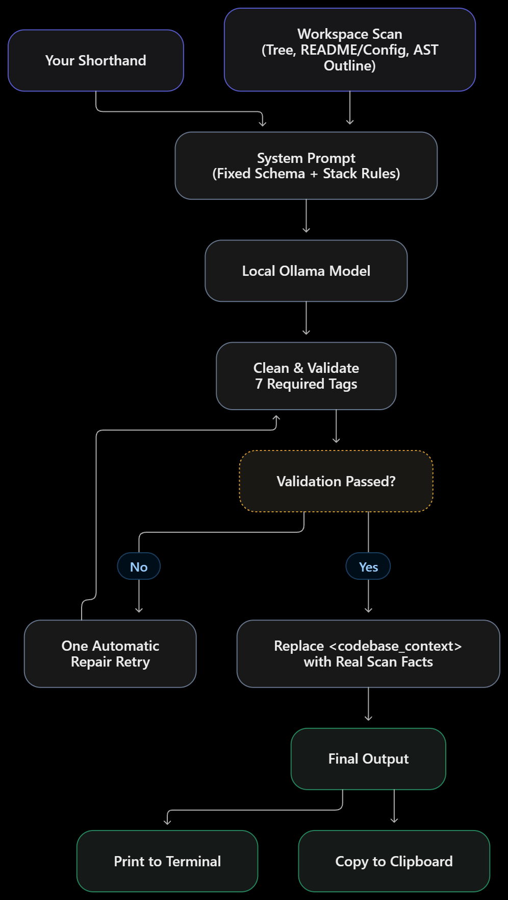

<div align="center">

# ⚡ PromptPump

**convert ideas into reality.**

[](https://pypi.org/project/promptpump/)
[](https://pypi.org/project/promptpump/)
[](LICENSE)

100% local · no API keys · prompts stay on your machine

</div>

```text
promptpump run "add source citations to each RAG answer" --stack fastapi
```

---

## Why PromptPump?

Generative AI tools are only as good as the prompt you give them. A short request like *"add a pause menu"*, *"a fox in a snowy forest"*, or *"write a tense opening scene"* can leave important details unspecified.

A great prompt has **structure** (role, objective, constraints, output format) and **context** (what your project actually looks like). Writing that by hand every time is slow, so people skip it.

PromptPump has three workflows, selected from the startup menu or with `--type`:

1. **Code** scans your project and adds file-aware implementation guidance and optional stack rules.
2. **Image** structures the subject, visual style, composition, lighting, and relevant constraints.
3. **Content** shapes stories, scripts, articles, and other writing around audience, structure, voice, and boundaries.
4. **Compiles locally** with Ollama and can copy the enhanced prompt to your clipboard.

### How PromptPump structures requests

| Without PromptPump | With PromptPump |
| --- | --- |
| *"add a pause menu"* | Role, measurable objective, success criteria, out-of-scope list |
| Image request is vague | Clear subject, style, composition, and lighting directions |
| Story request has no shape | Audience, narrative structure, voice, and constraints are explicit |
| Code model guesses your file layout | Real file tree and function signatures from **your** repo |
| Re-invents helpers it can see | Code mode is told to **reuse existing functions** |
| Silent assumptions | Unknowns listed under *Assumptions (verify before coding)* |
| Feature creep | Explicit scope rules and "files not to touch" |
| Rambling replies | Exact output format you want back (files, diffs, test plan) |

The goal is to reduce clarification rounds, wrong guesses, and cleanup. PromptPump does not
guarantee those outcomes; see the small code-generation pilot under [Evaluation status](#evaluation-status).

> PromptPump improves the *input*. Output quality still depends on the model that runs your final prompt, and the compiling model's reasoning. Always review the generated prompt before using it (see [Tips](#tips-for-best-results)).

---

## Install

**Requirements:** Python 3.10+ and [Ollama](https://ollama.com/download) (Windows, macOS, Linux).

### 1. Get a local model

```bash
ollama pull qwen2.5-coder:7b      # fast: ~19 tokens/s on a 6 GB laptop GPU (see Performance)
ollama pull qwen2.5-coder:14b     # stronger instruction-following in informal tests (~9 GB); ~6x slower on a 6 GB GPU
```

### 2. Install PromptPump

**Windows (PowerShell or cmd)**

```powershell
python -m pip install --user pipx
python -m pipx ensurepath
# close and reopen the terminal, then:
pipx install promptpump
```

**macOS / Linux**

```bash
python3 -m pip install --user pipx
python3 -m pipx ensurepath
# restart your shell, then:
pipx install promptpump
```

Plain pip works too: `pip install promptpump`. Linux clipboard support needs `xclip` or `xsel` (`sudo apt install xclip`).

### 3. Verify

```bash
promptpump --version
promptpump doctor        # checks Ollama is running and your model is installed
```

To use the 14B model by default: `setx PROMPTPUMP_MODEL "qwen2.5-coder:14b"` (Windows, then reopen the terminal) or `export PROMPTPUMP_MODEL=qwen2.5-coder:14b` (macOS/Linux).

---

## Quick start

Open a terminal **in your project folder** (PromptPump scans the current directory) and run:

```bash
cd my-project
promptpump run "add jwt auth to the api" --stack fastapi --stack python
```

The compiled prompt is printed and copied to your clipboard. Paste it into your AI assistant.

Run `promptpump` with no arguments to open the interactive menu. You can also choose a mode
directly:

```bash
promptpump run "a tiny astronaut tending a garden on the moon" --type image
promptpump run "write a 3-scene mystery short film set in a night train" --type content
```

Image and content modes do not scan the current folder. Code mode remains the default and
continues to use workspace context. Use an instruction-following Ollama model suited to
creative prompting (for example, `--model qwen2.5:7b` if installed); PromptPump enhances
prompts and does not generate the final image or story itself.

Local models can take a minute or two on CPU. Use `--timeout 900` for big models on slow machines.

### Examples

```bash
# Combine stacks
promptpump run "add a pause menu with resume and quit" --stack pygame --stack python

# Scan another folder
promptpump run "add rate limiting" --path ../my-api --stack fastapi

# Pipe to a file (progress goes to stderr, the prompt to stdout)
promptpump run "refactor the db layer" --no-copy > prompt.md

# Inspect exactly what would be sent to the model, without calling it
promptpump run "add caching" --dry-run

# Use a different model or a remote Ollama host
promptpump run "write tests for utils" -m qwen2.5-coder:14b --host http://192.168.1.20:11434
```

### Example output (abridged)

Input: `promptpump run "add source citations to each RAG answer" --stack fastapi`

```xml
<role_definition>
You are a senior Python engineer with expertise in FastAPI and retrieval systems...
</role_definition>

<task_objective>
Ensure every answer returned by the API cites the source documents it was built from.
Success criteria: ... Out of scope: ingestion, retrieval and ranking changes.
</task_objective>

<codebase_context>
File tree: api/main.py, eval/metrics.py, ...
Python modules (public API):
- api/main.py: class QueryResponse(BaseModel), def query_rag(request: QueryRequest)
- eval/metrics.py: def extract_citations(answer: str) -> set[str], ...
</codebase_context>

<architectural_specifications> ... reuse extract_citations from eval/metrics.py ... </architectural_specifications>
<implementation_steps> 1. ... 2. ... </implementation_steps>
<constraints_and_guardrails> ... Assumptions (verify before coding): ... </constraints_and_guardrails>
<expected_output_format> ... </expected_output_format>
```

Creative modes use different sections. For example, `--type image` structures visual subject,
style, composition, and lighting, while `--type content` structures audience, format, and voice.
Neither mode includes codebase context:

```bash
promptpump run "a fox in a snowy forest at dusk" --type image
```

---

## Command reference

| Command | Description |
| --- | --- |
| `promptpump run "<prompt>"` | Compile a shorthand prompt into a master prompt |
| `promptpump` or `promptpump menu` | Open the interactive code/image/content selector |
| `promptpump stacks` | List available stack profiles |
| `promptpump doctor` | Check Ollama connectivity and model availability |
| `promptpump telemetry` | Measure TTFT, tokens/sec, token counts, and peak GPU memory on your machine |
| `promptpump --version` | Show the installed version |

### `run` options

| Option | Default | Description |
| --- | --- | --- |
| `--type` | `code` | Prompt workflow: `code`, `image`, or `content` |
| `--stack`, `-s` | none | Inject stack rules; repeatable |
| `--copy / --no-copy` | copy | Copy the result to the clipboard |
| `--path`, `-p` | `.` | Project directory to scan |
| `--model`, `-m` | `qwen2.5-coder:7b` | Ollama model (env `PROMPTPUMP_MODEL`) |
| `--host` | `http://localhost:11434` | Ollama URL (env `PROMPTPUMP_HOST`) |
| `--max-context-tokens` | `3000` | Budget for the workspace snapshot |
| `--ground / --no-ground` | ground | Overwrite `<codebase_context>` with deterministic scan facts |
| `--timeout` | `300` | Seconds to wait for the model |
| `--num-ctx` | `8192` | Model context window (env `PROMPTPUMP_NUM_CTX`); lower it to save memory |
| `--rank / --no-rank` | rank | Pack the context budget by BM25 relevance to your prompt |
| `--stats` | off | Show token budget, input-reduction %, and model-side telemetry |
| `--tokenizer` | `heuristic` | Token counter: `heuristic`, `tiktoken` (needs `pip install 'promptpump[tokens]'`), `auto` |
| `--output`, `-o` | stdout | Write the prompt to a file (UTF-8) instead of printing it |
| `--log` | none | Save the warnings and stats shown on stderr to a file (UTF-8) |
| `--dry-run` | off | Print the payload and exit without calling the model |

### Stack profiles

Profiles cover common languages, frameworks, libraries, and tools. The names accepted by
`--stack` are:

- **Languages:** `python`, `javascript`, `typescript`, `java`, `kotlin`, `csharp`, `go`,
  `rust`, `c`, `cpp`, `php`, `ruby`, `swift`, `dart`, `scala`, `elixir`, `r`, `sql`, `bash`
- **Web and application frameworks:** `fastapi`, `django`, `flask`, `spring`, `aspnet`,
  `rails`, `laravel`, `react`, `nextjs`, `angular`, `vue`, `svelte`, `express`, `nestjs`,
  `react-native`, `flutter`, `electron`
- **Libraries, databases, and tools:** `pydantic`, `sqlalchemy`, `redis`, `celery`, `pandas`,
  `scikit-learn`, `pytorch`, `tensorflow`, `transformers`, `pygame`, `graphql`, `grpc`,
  `pytest`, `playwright`, `postgresql`, `mysql`, `mongodb`, `docker`, `terraform`, `node`

Use `promptpump stacks` to see labels and rule counts. Common aliases include `py`, `js`,
`ts`, `golang`, `c++`, `c#`, `dotnet`, `postgres`, `mongo`, `next`, `nodejs`, `torch`, and
`sklearn`. Stack
rules are defaults; the compiler skips any that conflict with conventions it sees in your
project. Combine profiles when useful, for example `--stack typescript --stack react --stack
playwright`.

---

## How it works

<p align="center">
  
</p>

**Built to be as deterministic as a local LLM allows**

- All modes use a fixed seed and low temperature; model outputs can still vary between runs.
- **Code mode** scans the selected workspace, validates its seven-section schema, grounds `<codebase_context>` in scan facts, and warns about unsupported file/function references or unrequested test/evaluation edits.
- **Image mode** validates image-specific sections for subject/scene, visual style, composition/lighting, and constraints. It skips workspace scanning, code grounding, and code-reference warnings.
- **Content mode** validates sections for audience/context, content structure, voice/style, and boundaries. It also skips workspace scanning, code grounding, and code-reference warnings.
- Filler text, reasoning blocks, and wrapping code fences are stripped in every mode. Missing required sections trigger one repair attempt.

**Safe by default**

- Respects the root `.gitignore`; skips `.git`, `node_modules`, `venv`, `__pycache__`, build folders, and binaries.
- Never reads or lists secrets: `.env`, `*.pem`, `*.key`, `id_rsa*`, `credentials.json`.
- Doesn't follow symlinks. Everything runs locally, and no network calls are made except to your Ollama server.

---

## Use as a Python library

```python
from promptpump import OllamaClient, PromptCompiler, scan_workspace

context = scan_workspace(".")
compiler = PromptCompiler(OllamaClient(model="qwen2.5-coder:14b"))
result = compiler.compile("add rate limiting", context, stacks=["fastapi"])

print(result.prompt)
print(result.is_valid, result.missing_tags)
```

---

## Token budget and input reduction

PromptPump packs your project into a fixed token budget (`--max-context-tokens`, default 3000): a file tree, key files (README, config, entry points), and a symbol outline of your code (Python via `ast`; JS/TS and Go via lightweight regexes). Outlines are packed in **BM25 relevance order** for your prompt, so the budget goes to the files most likely to matter instead of whatever comes first alphabetically.

```bash
promptpump run "add retry logic to the ollama client" --stats --dry-run
```

`--stats` prints the budget breakdown and the **input reduction versus pasting the whole repository** (every non-ignored text file, counted with the same tokenizer). The percentage depends on your repo and budget; it is measured per run, never assumed.

- Token counts use a deterministic heuristic (~4 characters/token) by default, so numbers are identical on every machine. `--tokenizer tiktoken` gives an OpenAI-tokenizer approximation. The only exact model-side figure is Ollama's `prompt_eval_count`, shown by `--stats` after a real run.
- A big reduction is only a win if the relevant files survive. The library exposes `gold_file_recall(context, files)` to check that, and the upcoming benchmark reports it alongside accuracy.
- Ranking is lexical (BM25 over file paths, symbol names, and text), not semantic, so a prompt that uses different words than your code can rank poorly. Naming a file or function in the shorthand helps.

## Performance and telemetry

Measure your own hardware with one command:

```bash
promptpump telemetry --path . --runs 10 --write-readme README.md
```

It runs a fixed compile workload repeatedly (the first run is a cold start, with every loaded model evicted first) and reports **TTFT**, **decode tokens/sec**, model-side input/output tokens, and **peak GPU memory** (from `nvidia-smi`; N/A when no NVIDIA GPU is detected, never estimated). It also records the hardware, model, and quantization so the numbers can be interpreted. Prefer `--write-readme` or `--json-out` over copying from the terminal, which can drop spaces at line wraps.

### Measured example: a 6 GB laptop GPU

Nov 2026, PromptPump 0.2.0.dev0, Ollama 0.40.16, Windows 11, Intel Core i5-12450HX, 15.8 GB RAM, NVIDIA RTX 3050 6GB Laptop GPU. Same workload for both models (about 3.9k input tokens). The 7B run used 5 warm runs and the 14B run 9; both are single-machine measurements.

| Metric | `qwen2.5-coder:7b` (Q4_K_M) | `qwen2.5-coder:14b` (Q4_K_M) |
| --- | ---: | ---: |
| Decode speed, warm (tokens/s) | 18.6 | 3.2 |
| TTFT, warm median (s) | 2.16 | 2.56 |
| TTFT, cold start (s) | 19.46 | 34.40 |
| Time for the model call, warm median (s) | 27.1 | 167.9 |
| Time for the model call, cold start (s) | 53.0 | 217.3 |
| Output tokens, warm median | 464 | 533 |
| Peak GPU memory, whole GPU (MiB) | 4,666 | 4,619 |
| Share of model on GPU | 79% | not recorded* |

\* The 14B share was not captured in that historical run. The README does not retain the
per-model GPU placement value required to calculate it, and whole-GPU peak memory cannot
determine the model's share reliably, so the value is left unestimated.

Reading it: decode speed, not input size, dominates the time. On this card the 14B model does not fit in VRAM and runs partly on the CPU, so it is about six times slower than the 7B for the same task. Output length also differed between runs even with a fixed seed, so repeated runs are similar but not identical. Faster GPUs with more VRAM will look very different; run the command above for your own numbers.

### Your machine's full table

<!-- promptpump:telemetry:start -->
- **Model:** qwen2.5-coder:14b 14.8B Q4_K_M
- **GPU:** NVIDIA GeForce RTX 3050 6GB Laptop GPU (6,144 MiB)
- **Model placement:** 4,017 of 10,317 MiB on GPU (39%), remainder on CPU/RAM
- **CPU / RAM:** 12th Gen Intel(R) Core(TM) i5-12450HX / 15.8 GB
- **OS / Ollama:** Windows-11-10.0.26200-SP0 / 0.40.16
- **Runs:** 2 (1 warm), shorthand: `add input validation and clear error messages to the main entry point`

| Metric | Cold start (run 1) | Warm median | Warm worst case |
| --- | ---: | ---: | ---: |
| TTFT (s) | 28.43 | 2.43 | 2.43 |
| Decode speed (tokens/s) | 3.2 | 3.3 | 3.3 |
| Time for the model call (s) | 246.86 | 212.77 | 212.77 |
| Input tokens (model-side) | 4,075 | 4,075 | - |
| Output tokens | 706 | 690 | - |
| Peak GPU memory, absolute (MiB) | 5,021 | 5,005 | 5,005 |
| Peak GPU memory, delta over pre-load idle (MiB) | 4,030 | 4,014 | 4,014 |

_TTFT is wall-clock time from request to first streamed token (cold start includes model load). Decode speed is Ollama's `eval_count / eval_duration`; its worst case is the 5th percentile, latency worst cases are the 95th. GPU memory is read from `nvidia-smi` for the whole GPU, so use the delta column when other programs share it._
<!-- promptpump:telemetry:end -->

This current run measures `qwen2.5-coder:14b` Q4_K_M. Ollama reports 4,017 MiB of the
10,317 MiB model allocation on the GPU (39%), with the rest on CPU/RAM. The peak and delta
rows above come from `nvidia-smi` and describe the whole GPU. The earlier 14B value in the
example table remains unrecorded because that historical run did not capture per-model
placement.

## Evaluation status

**Automated test suite (2026-11-22):** `python -m pytest -q` — **84 passed** (2 dependency deprecation warnings).

**Prompt-quality pilot (2026-11-22, final run):** three synthetic Python tasks, one generation
per task and condition, using `qwen2.5-coder:7b-instruct-q4_K_M` with Ollama 0.40.16. All
variants used the same code-generation model and fixture tests; PromptPump also used that model
to compile its prompt. A condition passes a task only when every test passes. PromptPump allows
two repair attempts for malformed output and recovers a malformed final output-format section.

| Task | Raw request | Full repository dump | PromptPump prompt |
| --- | ---: | ---: | ---: |
| Feature flags | Fail | Pass | Pass |
| Retry-After parsing | Fail | Pass | Pass |
| Unicode URL slug | Fail | Fail | Pass |
| **Tasks passed** | **0/3** | **2/3** | **3/3** |

PromptPump passed all three tasks in this run; the full dump passed two and the raw request
passed none. This single-model, single-sample pilot is too small to support broad quality
claims. Treat improvement claims as a hypothesis until more tasks, models, and repeated
generations are measured. The [benchmark harness and fixtures](benchmarks/prompt_quality/README.md)
and [raw results](benchmarks/prompt_quality/results/0.2.0-pilot.json) are included for review.

Reproduce with `python benchmarks/prompt_quality/run.py --model qwen2.5-coder:7b-instruct-q4_K_M`.

---

## Tips for best results

- **Run it from your project root** so the scan reflects the real code.
- **Be specific in the shorthand.** *"In api/main.py, make query_rag require [Source N] markers and return them in QueryResponse"* gives a much tighter prompt than *"add citations"*.
- **Pick the model for your hardware.** The 14B model follows instructions better in informal tests but needs a GPU with roughly 12 GB of VRAM to run at a comfortable speed; on a 6 GB laptop GPU the 7B is the practical choice.
- **Review before you paste.** Check file names, assumptions, and scope. Small local models can still misread intent.
- Use `--dry-run` to see what the model receives, and `--max-context-tokens` to give larger projects more context.

---

## Troubleshooting

| Problem | Fix |
| --- | --- |
| `pipx` / `promptpump` not recognized (Windows) | Run `python -m pipx ensurepath`, then **reopen** the terminal |
| `Ollama ran out of memory` | Run `ollama ps`, then `ollama stop <model>` for models you are not using; close heavy apps; use a smaller model or `--num-ctx 6144` |
| Garbled characters (`Γö£ΓÇÉ`) or `NativeCommandError` after `> file` / `2> file` in Windows PowerShell 5.1 | PowerShell re-encodes redirected output. Use `--output prompt.md` and `--log notes.txt` instead: PromptPump writes both files itself as UTF-8 |
| `Cannot reach Ollama` | Start it with `ollama serve` (or open the Ollama app) and run `promptpump doctor` |
| `Model ... not found` | `ollama pull qwen2.5-coder:7b` (or the model you chose) |
| Timeout on a slow machine | Add `--timeout 900`, or use the 7B model |
| Clipboard unavailable (Linux) | `sudo apt install xclip` |
| Output has missing sections | Try the 14B model or rephrase the shorthand |
| Scan looks wrong | You're probably in the wrong folder; `cd` into the project or pass `--path` |

---

## Development

```bash
git clone https://github.com/RiteshNipane/PromptPump.git
cd PromptPump
python -m venv .venv
.venv\Scripts\activate           # macOS/Linux: source .venv/bin/activate
pip install -e ".[dev]"
pytest
```

```text
promptpump/
├── cli.py        # Typer CLI (run, menu, stacks, doctor, telemetry, --version)
├── engine.py     # Ollama client, compiler loop, validation, grounding
├── context.py    # Workspace scanner: tree, key files, relevance-packed outlines
├── outline.py    # Symbol outlines (Python ast, JS/TS and Go regex)
├── rank.py       # BM25 relevance ranking
├── stats.py      # Token accounting, reduction %, gold-file recall
├── telemetry.py  # TTFT, tokens/sec, peak GPU memory, hardware report
├── tokens.py     # Token counters
├── templates.py  # Prompt mode schemas and system prompt assembly
└── stack_profiles.py  # Stack definitions, aliases, and canonical resolution
```

Adding a stack is one entry in `stack_profiles.py`. Pull requests and issues are welcome.

## License

[MIT](LICENSE) © Ritesh Nipane
