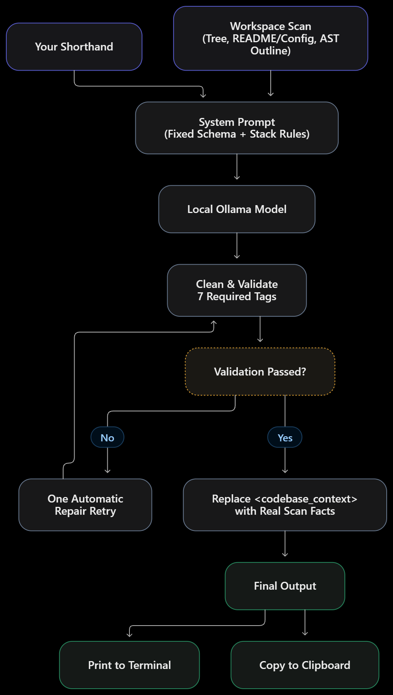

<div align="center">

# ⚡ PromptPump

**Enhance your prompt from a one-line idea into a production-grade coding prompt, using your own codebase and a local LLM.**

[](https://pypi.org/project/promptpump/)
[](https://pypi.org/project/promptpump/)
[](LICENSE)

100% local · no API keys · no code leaves your machine

</div>

```text
promptpump run "add source citations to each RAG answer" --stack fastapi
```

---

## Why PromptPump?

AI coding assistants are only as good as the prompt you give them. Most of us type something like *"add a pause menu"* and then spend the next ten messages fixing what the model guessed wrong: wrong files, duplicated helpers, invented APIs, scope creep.

A great prompt has **structure** (role, objective, constraints, output format) and **context** (what your project actually looks like). Writing that by hand every time is slow, so people skip it.

PromptPump does it for you:

1. **Scans your project**: file tree, README and config snippets, and an AST outline of your Python modules (classes, functions, signatures).
2. **Applies a strict schema**: seven fixed sections, plus optional stack rules (FastAPI, React, Pygame, PyTorch...).
3. **Compiles with a local model**: Ollama + Qwen2.5-Coder turns your shorthand into a dense master prompt.
4. **Copies it to your clipboard**, ready to paste into Claude, ChatGPT, Cursor, Copilot, or any agent.

### How a better prompt improves your coding

| Without PromptPump | With PromptPump |
| --- | --- |
| *"add a pause menu"* | Role, measurable objective, success criteria, out-of-scope list |
| Model guesses your file layout | Real file tree and function signatures from **your** repo |
| Re-invents helpers you already have | Told to **reuse existing functions** it can see |
| Silent assumptions | Unknowns listed under *Assumptions (verify before coding)* |
| Feature creep | Explicit scope rules and "files not to touch" |
| Rambling replies | Exact output format you want back (files, diffs, test plan) |

Fewer clarification rounds, fewer wrong guesses, and less cleanup afterwards.

> PromptPump improves the *input*. Output quality still depends on the model that runs your final prompt, and the compiling model's reasoning. Always review the generated prompt before using it (see [Tips](#tips-for-best-results)).

---

## Install

**Requirements:** Python 3.10+ and [Ollama](https://ollama.com/download) (Windows, macOS, Linux).

### 1. Get a local model

```bash
ollama pull qwen2.5-coder:7b      # fast, runs on most machines
ollama pull qwen2.5-coder:14b     # recommended: noticeably better prompts (~9 GB, needs ~12 GB RAM/VRAM)
```

### 2. Install PromptPump

**Windows (PowerShell or cmd)**

```powershell
python -m pip install --user pipx
python -m pipx ensurepath
# close and reopen the terminal, then:
pipx install promptpump
```

**macOS / Linux**

```bash
python3 -m pip install --user pipx
python3 -m pipx ensurepath
# restart your shell, then:
pipx install promptpump
```

Plain pip works too: `pip install promptpump`. Linux clipboard support needs `xclip` or `xsel` (`sudo apt install xclip`).

### 3. Verify

```bash
promptpump --version
promptpump doctor        # checks Ollama is running and your model is installed
```

To use the 14B model by default: `setx PROMPTPUMP_MODEL "qwen2.5-coder:14b"` (Windows, then reopen the terminal) or `export PROMPTPUMP_MODEL=qwen2.5-coder:14b` (macOS/Linux).

---

## Quick start

Open a terminal **in your project folder** (PromptPump scans the current directory) and run:

```bash
cd my-project
promptpump run "add jwt auth to the api" --stack fastapi --stack python
```

The compiled prompt is printed and copied to your clipboard. Paste it into your AI assistant.

Local models can take a minute or two on CPU. Use `--timeout 900` for big models on slow machines.

### Examples

```bash
# Combine stacks
promptpump run "add a pause menu with resume and quit" --stack pygame --stack python

# Scan another folder
promptpump run "add rate limiting" --path ../my-api --stack fastapi

# Pipe to a file (progress goes to stderr, the prompt to stdout)
promptpump run "refactor the db layer" --no-copy > prompt.md

# Inspect exactly what would be sent to the model, without calling it
promptpump run "add caching" --dry-run

# Use a different model or a remote Ollama host
promptpump run "write tests for utils" -m qwen2.5-coder:14b --host http://192.168.1.20:11434
```

### Example output (abridged)

Input: `promptpump run "add source citations to each RAG answer" --stack fastapi`

```xml
<role_definition>
You are a senior Python engineer with expertise in FastAPI and retrieval systems...
</role_definition>

<task_objective>
Ensure every answer returned by the API cites the source documents it was built from.
Success criteria: ... Out of scope: ingestion, retrieval and ranking changes.
</task_objective>

<codebase_context>
File tree: api/main.py, eval/metrics.py, ...
Python modules (public API):
- api/main.py: class QueryResponse(BaseModel), def query_rag(request: QueryRequest)
- eval/metrics.py: def extract_citations(answer: str) -> set[str], ...
</codebase_context>

<architectural_specifications> ... reuse extract_citations from eval/metrics.py ... </architectural_specifications>
<implementation_steps> 1. ... 2. ... </implementation_steps>
<constraints_and_guardrails> ... Assumptions (verify before coding): ... </constraints_and_guardrails>
<expected_output_format> ... </expected_output_format>
```

---

## Command reference

| Command | Description |
| --- | --- |
| `promptpump run "<prompt>"` | Compile a shorthand prompt into a master prompt |
| `promptpump stacks` | List available stack profiles |
| `promptpump doctor` | Check Ollama connectivity and model availability |
| `promptpump --version` | Show the installed version |

### `run` options

| Option | Default | Description |
| --- | --- | --- |
| `--stack`, `-s` | none | Inject stack rules; repeatable |
| `--copy / --no-copy` | copy | Copy the result to the clipboard |
| `--path`, `-p` | `.` | Project directory to scan |
| `--model`, `-m` | `qwen2.5-coder:7b` | Ollama model (env `PROMPTPUMP_MODEL`) |
| `--host` | `http://localhost:11434` | Ollama URL (env `PROMPTPUMP_HOST`) |
| `--max-context-tokens` | `3000` | Budget for the workspace snapshot |
| `--ground / --no-ground` | ground | Overwrite `<codebase_context>` with deterministic scan facts |
| `--timeout` | `300` | Seconds to wait for the model |
| `--dry-run` | off | Print the payload and exit without calling the model |

### Stack profiles

`python` · `fastapi` · `django` · `react` · `nextjs` · `node` · `pygame` · `pytorch`

Aliases such as `py`, `next`, `nodejs`, and `torch` also work. Stack rules are defaults; the compiler is told to skip any that conflict with conventions it sees in your project.

---

## How it works

<p align="center">
  
</p>

**Built to be as deterministic as a local LLM allows**

- Fixed system prompt and stack rules, temperature `0.2`, fixed seed.
- Output validated against seven required sections: `role_definition`, `task_objective`, `codebase_context`, `architectural_specifications`, `implementation_steps`, `constraints_and_guardrails`, `expected_output_format`.
- Filler text, reasoning blocks, and wrapping code fences are stripped.
- The `<codebase_context>` section is overwritten with real scan data so the model cannot invent files.

**Safe by default**

- Respects the root `.gitignore`; skips `.git`, `node_modules`, `venv`, `__pycache__`, build folders, and binaries.
- Never reads or lists secrets: `.env`, `*.pem`, `*.key`, `id_rsa*`, `credentials.json`.
- Doesn't follow symlinks. Everything runs locally, and no network calls are made except to your Ollama server.

---

## Use as a Python library

```python
from promptpump import OllamaClient, PromptCompiler, scan_workspace

context = scan_workspace(".")
compiler = PromptCompiler(OllamaClient(model="qwen2.5-coder:14b"))
result = compiler.compile("add rate limiting", context, stacks=["fastapi"])

print(result.prompt)
print(result.is_valid, result.missing_tags)
```

---

## Tips for best results

- **Run it from your project root** so the scan reflects the real code.
- **Be specific in the shorthand.** *"In api/main.py, make query_rag require [Source N] markers and return them in QueryResponse"* gives a much tighter prompt than *"add citations"*.
- **Use the 14B model** if your hardware allows. 7B models drift more.
- **Review before you paste.** Check file names, assumptions, and scope. Small local models can still misread intent.
- Use `--dry-run` to see what the model receives, and `--max-context-tokens` to give larger projects more context.

---

## Troubleshooting

| Problem | Fix |
| --- | --- |
| `pipx` / `promptpump` not recognized (Windows) | Run `python -m pipx ensurepath`, then **reopen** the terminal |
| `Cannot reach Ollama` | Start it with `ollama serve` (or open the Ollama app) and run `promptpump doctor` |
| `Model ... not found` | `ollama pull qwen2.5-coder:7b` (or the model you chose) |
| Timeout on a slow machine | Add `--timeout 900`, or use the 7B model |
| Clipboard unavailable (Linux) | `sudo apt install xclip` |
| Output has missing sections | Try the 14B model or rephrase the shorthand |
| Scan looks wrong | You're probably in the wrong folder; `cd` into the project or pass `--path` |

---

## Development

```bash
git clone https://github.com/RiteshNipane/PromptPump.git
cd PromptPump
python -m venv .venv
.venv\Scripts\activate           # macOS/Linux: source .venv/bin/activate
pip install -e ".[dev]"
pytest
```

```text
promptpump/
├── cli.py        # Typer CLI (run, stacks, doctor)
├── engine.py     # Ollama client, compiler loop, validation, grounding
├── context.py    # Workspace scanner (tree, key files, AST outlines)
└── templates.py  # System prompt schema and stack rules
```

Adding a stack is one entry in `templates.py`. Pull requests and issues are welcome.

## License

[MIT](LICENSE) © Ritesh Nipane
